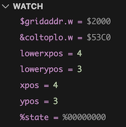

# Beeb VSC
A [Visual Studio Code](https://code.visualstudio.com/) Extension to support code development for the Acorn BBC Micro/Master range of 6502 based micro computers from the 1980's.

Visual Studio Code is free and really good for general retro/6502 development, so this extension was created to enhance the experience by providing syntax colouring for 6502 opcodes, labels, and BBC BASIC commands & functions supported by [BeebAsm](https://github.com/stardot/beebasm) as well as various types of VS Code functionality.

See the [CHANGELOG](./CHANGELOG.md) for full release history.

# Features

## Syntax Highlighting:
- All **6502 op-codes** (no 65C02 op codes yet)
- **.label** style labels
- **$** or **&** style hex constants
- All **BBC BASIC** style keywords (such as `TAN`, `RND`, `MOD`, `DIV` etc.)
- All **BeebAsm** directives (such as `ORG`, `GUARD`, `SKIP` etc.)

## Hover Information:
- BeebAsm functions (`RND`, `CHR$`, `LO` etc.)
- BeebAsm directives (`SAVE`, `EQUB`, `ORG` etc.)
- Op-code information (description, bytecode, cycles etc.)
- Symbols and labels show the line of code where they are declared
- Can also show cycle count as inlay hints

## References:
The various types of reference navigation options available within VS Code via the context menu (right-click on a symbol or label).
- Go to definition
- Find all references
- Peek definition/references
- Links added to files referenced via `INCLUDE`, `PUTBASIC` or `PUTTEXT`
- The rename refactoring functionality is also included

## Diagnostics:
The extension parses your code to try and identify the errors that would be reported by BeebAsm when compiling your code. Lines with issues will be underlined and reported in the Problems tab of VS Code. Dozens of issues are detected including:
- BeebAsm function and directive syntax errors
- Assembly errors (e.g. branch out of bounds, invalid addressing modes)

## Completions:
Provides a list of potential matches as you start to type.
- BeebAsm functions
- BeebAsm directives
- Symbols and labels

## Supported Filetypes:
- `.6502`
- `.asm`
- `.s`

## Build tools
- Assemble & test 6502 projects all within Visual Studio Code
- Build and run tasks are provided automatically for your source files, with no `tasks.json` needed
- Assembly errors are parsed by the `$beebasm` problem matcher and sent to VSC's built-in error navigation view
- Uses Visual Studio Code tasks for building & testing, so you can customise them in `tasks.json` if you want
- Easily create new build targets (supports multiple targets within a project folder)
- Easily select 'default' build targets
- Run build targets in the emulator of your choice
- Works on Linux, macOS and Windows with sensible default tool names

## Integrated BBC Micro Emulator

- [Preview your projects](./docs/emulator.md) directly within VSCode using an integrated [JSBeeb](https://github.com/mattgodbolt/jsbeeb) emulator
- Even debug your projects by setting breakpoints in your code, steping through and monitoring how values change (using named symbols and labels).


# Quick Setup

## 1. Install the extension
Press CTRL+Shift+X in VS Code, search for 'beeb vsc' or 'beebasm', click install.

## 2. Install Assembler and Emulator
Install [BeebAsm](https://github.com/stardot/beebasm) and an external emulator so that they can be found on your `PATH`. If the `beebvsc.assembler` and `beebvsc.emulator` settings are left empty, BeebVSC uses these platform defaults:

| Platform      | Assembler     | Emulator     |
|---------------|---------------|--------------|
| Linux / macOS | `beebasm`     | `b-em`       |
| Windows       | `BeebAsm.exe` | `BeebEm.exe` |

If a tool isn't on your `PATH`, or you use a different emulator, set its name or full path in your **user** settings (see [Changing Assembler and/or Emulator configuration](#changing-assembler-andor-emulator-configuration)). If BeebVSC can't find a tool when you build or run, it shows a warning with a button to open the relevant setting.

## 3. Load your project
Open your project folder in VSC. Syntax colouring will automatically activate when `.6502`, `.asm`, or `.s` files are opened in the editor.


## 4. Build
Press `Ctrl+Shift+B` (or `F7` in a 6502 source file). BeebVSC provides a build task for each of your source files automatically, so this works straight away without any configuration files. If there's more than one, VS Code asks which to build; to make the choice permanent, run **Tasks: Configure Default Build Task** from the command palette.

The source file is assembled into a disk image `<sourcefile>.ssd`, which boots the first file named in a `SAVE` directive. Any errors output by the assembler are captured in Visual Studio Code's `Problems` view.

BeebVSC finds source files as follows:
- if `beebvsc.sourceFile` is set in `.vscode/settings.json` (see the next step), those files are used
- otherwise, every `.6502` file in the folder, plus any `.asm` or `.s` file containing a `SAVE` directive (these extensions are also used by other assemblers, so the check avoids offering tasks for unrelated files)

## 5. Create a build target (recommended)
A build target records your main source file(s) in `.vscode/settings.json`, so that code navigation and diagnostics follow the right `INCLUDE` order even when you're looking at an included file. When you open a folder that has 6502 source files but no target, BeebVSC offers (once) to create one. You can also run `BeebVSC: Create new build target` from the command palette (`Ctrl+Shift+P`) at any time, and pick a source file from the list.


Creating a target also writes build and run tasks for it to `.vscode/tasks.json`, which you are free to edit.


## 6. Run the target
Press `Ctrl+F7` in a 6502 source file, or run **Tasks: Run Test Task**, and Visual Studio Code will run your disk image in the configured external emulator.

Alternatively, right-click on your disk image and select `BeebVSC: Open Emulator` to open it in the built-in copy of JSBeeb.

## 7. Debug (experimental)
Press `F5`. With no `launch.json`, BeebVSC works out the current target, builds it, regenerates its source map, and starts debugging it in the built-in JSBeeb emulator. It then offers to save that configuration to `.vscode/launch.json` so you can customise it; you can also do this at any time with `BeebVSC: Create launch.json for the current target`.

You can now set breakpoints in your code, add watch points and step through the code. See the [debugging](#debugging) section below for more details.

**That's it! Have fun!**

## Keyboard shortcuts
These shortcuts only apply while editing a 6502 source file, so they don't override VS Code's own keys elsewhere:

| Key        | Command                                   |
|------------|-------------------------------------------|
| `F7`       | Build the default target                  |
| `Shift+F7` | Select the default build target           |
| `Ctrl+F7`  | Run the target in the external emulator   |

`Ctrl+Shift+B` (build) works everywhere, as usual. Earlier versions of BeebVSC also used `F6`, `F9`, `F10`, `Ctrl+Shift+T` and `Ctrl+Shift+R`. These are now left free for VS Code's own Focus Next Part, Toggle Breakpoint, Step Over, Reopen Closed Editor and Refactor commands, which are handy while debugging. If you prefer the previous keys, add them to your `keybindings.json` (**Preferences: Open Keyboard Shortcuts (JSON)**), for example:
```json
[
    { "key": "f10", "command": "beebvsc.target.create", "when": "editorLangId == beebasm && !inDebugMode" }
]
```

# Advanced Usage

## Changing Assembler and/or Emulator configuration
Open the settings (`Ctrl+,`) and search for `beebvsc`. The settings are:

| Setting                         | Default                   | Description |
|---------------------------------|---------------------------|-------------|
| `beebvsc.assembler`             | empty (platform default)  | Assembler name on your `PATH`, or full path |
| `beebvsc.emulator`              | empty (platform default)  | External emulator name on your `PATH`, or full path |
| `beebvsc.emulatorArgs`          | `["${diskImage}"]`        | Emulator command line. `${diskImage}` is replaced by the disk image; if it isn't used, the disk image is added at the end |
| `beebvsc.promptToCreateTarget`  | `true`                    | Offer to create a build target in folders that don't have one |
| `beebvsc.enableInlayHints`      | `false`                   | Show cycle counts inline |

Full paths to executables work, but we recommend putting them in your user settings rather than the project's `.vscode/settings.json`, since they are not portable if your project source is shared. For safety, in a folder you haven't marked as trusted, the assembler and emulator settings are only read from your user settings.


## Managing multiple build targets
You can run the add build target command multiple times to add additional source files to the list of build targets in the `tasks.json` file.

## Switching between build targets
It is possible to switch between build targets as follows:

Press `Shift+F7` (or run `BeebVSC: Select default build target`) and the extension will provide a drop down list of build targets currently in the `tasks.json` file.


The selection you make will become the new default 'build' and 'test' target, which can then be built as normal by pressing `F7` or `Ctrl+Shift+B`, or run in the emulator with `Ctrl+F7`.

**NOTE:** It is not possible to add duplicate targets, also note that only one target can be built at once.

## Listing commands
Press `Ctrl+Shift+P` to open the command palette. In here you will see the BeebVSC commands listed for reference/convenience.


## Running specific tasks
BeebVSC takes advantage of standard Visual Studio Code 'tasks'. Run **Tasks: Run Task** from the command palette to list all of the current tasks, including the ones BeebVSC provides automatically (under `beebvsc`), and pick one to run.


## Adding custom tasks
The BeebVSC extension is careful to preserve the contents of the `tasks.json` file. Therefore once targets(tasks) have been added, is very easy to manually configure or override them by simply making modifications to the `tasks.json` file directly:
- You can rename targets if you wish, there is no logic dependent on this
- You can modify commandline arguments if you wish
- You can your own additional commandline tasks if you like (eg. for compiling other data etc.)
- You can manually remove tasks if you wish

The only property that is managed by the extension is `Group -> Kind`, so this is subject to modification.
Note also that the commandline argument for the test task is managed by the extension, and updates whenever a new build target is selected.

### `beebvsc` tasks
Instead of shell commands, you can also write tasks of type `beebvsc` in `tasks.json`. BeebVSC fills in the command line when the task runs, using your current assembler and emulator settings, so the same `tasks.json` works on every machine:
```json
{
    "version": "2.0.0",
    "tasks": [
        {
            "label": "Build game",
            "type": "beebvsc",
            "action": "build",
            "sourceFile": "main.6502",
            "diskImage": "game.ssd",
            "bootFile": "Loader",
            "extraArgs": ["-title", "MYGAME"],
            "problemMatcher": ["$beebasm"],
            "group": { "kind": "build", "isDefault": true }
        },
        {
            "label": "Run game",
            "type": "beebvsc",
            "action": "run",
            "diskImage": "game.ssd",
            "group": { "kind": "test", "isDefault": true }
        }
    ]
}
```
Only `action` is required. `diskImage` defaults to the source file name with a `.ssd` extension, and `bootFile` defaults to the first `SAVE` name in the source file. The `$beebasm` problem matcher can also be used in your own shell tasks.

## Directly managing target source files
If you don't want to use BeebVSC's functionality to add build targets, some functionality will be limited because the extension will not know what order INCLUDE files are processed. In this case, it is necessary to add the target file(s) to the `settings.json` file. For example, if the targets `build.asm` and `loader.asm` are run through BeebAsm then the settings file would look like: 
```json
{
    "beebvsc": {
        "sourceFile": [
            "/Users/Games/Test/build.asm",
            "/Users/Games/Test/loader.asm"
        ],
        "targetName": "main.ssd"
    }
}
```
The easiest way to set this up is adding the build targets in a normal way and they removing the `tasks.json` entries if those are not wanted.

## Debugging
The debugger uses a source map to relate each instruction in your code to the address where it runs. Source maps are created by the `BeebVSC: Create source map` command, which uses the built-in logic from BeebAsm. If your file is called `build.asm`, it creates `build.asm.map` with information about labels, symbols, and the addresses at which instructions are run. Eventually it would be better to have this file generated by BeebAsm itself but while the feature is experimental, this gives us more control.

**Source maps are now regenerated automatically** each time you start debugging, for every `.map` file listed in `sourceMapFiles` whose source file exists (`build.asm.map` is regenerated from `build.asm`). To turn this off for a configuration, add `"createSourceMaps": false` to it in `launch.json`.

There are three ways to start debugging:
1) Press `F5` with no `launch.json`: BeebVSC builds the current target and debugs it, then offers to save the configuration
2) Right-click on the disk image and select `BeebVSC: Debug`
3) Set up a `launch.json` file so that you can press `F5` to start debugging with a specific disk image and named source map file(s). Run `BeebVSC: Create launch.json for the current target`, or go to the `Run and Debug` panel in VS Code and click `create a launch.json file`, to get a configuration for your current target.

Example `launch.json`
``` json
{
    "version": "0.2.0",
    "configurations": [
        {
            "type": "jsbeebdebugger",
            "request": "launch",
            "name": "Debug mygame.ssd in jsbeeb",
            "diskImage": "${workspaceFolder}/mygame.ssd",
            "sourceMapFiles": [
                "build.asm.map"
            ],
            "preLaunchTask": {
                "type": "beebvsc",
                "action": "build",
                "sourceFile": "build.asm",
                "diskImage": "mygame.ssd"
            }
        }
    ]
}
```
The `preLaunchTask` builds the disk image before each debugging session. It can also be the label of one of your own tasks, e.g. `"preLaunchTask": "BeebVSC Build Target 'mygame.ssd'"`.

### Creating source maps from tasks (optional)
If you want source maps regenerated on every build, not just when debugging, add a task that runs the command:
```json
        {
            "label": "Create source map",
            "command": "${command:beebvsc.createSourceMap}",
        },
```
Then add a `"dependsOn"` property to the main build task that calls this one e.g.
```json
            "dependsOn": [
                "Create source map"
            ],
```

Note that a limitation of this approach is that we aren't specifying the source file to create a source map for, so the editor window with focus needs to be one of the source files. It is possible to specify a source file within the `tasks.json` file with a bit more scaffolding. We need to create a separate `input` type entry and then modify the "Create source map" task from above to call that `input`:
```json
    "inputs": [
        {
            "id": "createSourceMap",
            "type": "command",
            "command": "beebvsc.createSourceMap",
            "args": {
                "sourceFile": "test.6502"
            }
        }
    ],
    "tasks": [
        {
            "label": "Create source map",
            "type": "shell",
            "command": "echo",
            "args": ["'${input:createSourceMap}'"],
            "problemMatcher": []
        },
```

### Watches and data breakpoints
Watches can be set for symbols and labels from your code (assuming they relate to 16 bit addresses).
 - Add prefix of `$` or `&` for hex display, `%` for binary display, leave blank for decimal
 - add suffix of `.w` for 16 bit (little endian) reference or `.d` for 32 bit. Defaults to 8 bit value

Examples:



After a watch has been added and the execution is paused, you can add read or write data breakpoints by right-clicking on the entry in the watch list and choosing `Break on {read|change|access}`.

## Inlay hints for cycle count
The cycle count for each assembly instruction can be shown inline by enabling the setting `"beebvsc.enableInlayHints"`. The precise behaviour is controlled from the standard VS Code setting `"editor.inlayHints.enabled"`.


## Linux/Mac support
Linux and macOS are supported out of the box: with the default (empty) settings, BeebVSC runs `beebasm` and `b-em` from your `PATH`. On Ubuntu, for example, build BeebAsm and B-Em from source (see their READMEs), make sure both are on your `PATH`, then open your project folder and press `Ctrl+Shift+B`.

To use a different emulator, set `beebvsc.emulator`, and `beebvsc.emulatorArgs` if it needs extra command line options to load and boot a disk image (see your emulator's documentation).

**Possible further features to add**
- Support for BBC BASIC text files (can be compiled to SSD via BeebAsm) and full syntax colouring
- Support 'remove target' feature
- Support different 6502 assemblers
- Support more debug targets e.g. B2


## Contributors & Kudos

Many thanks to the following people who have contributed directly & indirectly to this project:

* **[Tom Helm](https://github.com/tommy9)**
* **[Rich Talbot-Watkins](https://github.com/richtw1)**
* **[Matt Godbolt](https://github.com/mattgodbolt)**

More information [here](docs/extension-development.md) about developing the extension.

## Acorn Community

### Development tools
- [Rich Talbot-Watkin's rather brilliant BeebAsm project](https://github.com/stardot/beebasm/blob/master/README.md)

### Emulators
- [BeebEm Emulator](http://www.mkw.me.uk/beebem/index.html)
- [BeebEm Emulator for Windows](https://github.com/stardot/beebem-windows)
- [B2 emulator](https://github.com/tom-seddon/b2)
- [B-Em emulator](https://github.com/stardot/b-em)
- [JSBeeb Emulator](https://bbc.godbolt.org/)

### BBC Micro/6502 Resources:
- [Stardot Acorn/BBC Micro forums](http://stardot.org.uk/forums/)
- [Stardot Github](https://github.com/stardot)
- [bbcmicro.co.uk](https://bbcmicro.co.uk/)
- [Owlet BBC Basic Editor](https://bbcmic.ro/)
- [BBC Micro Bot](https://www.bbcmicrobot.com/)


